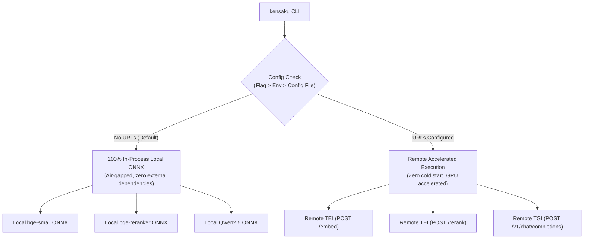

# Task 07: Remote TEI/TGI Endpoint Configuration & CLI Config Command

## Objective
Implement a configuration system and `kensaku config` CLI command that defaults to **100% in-process local ONNX**, but allows users to configure remote **Hugging Face TEI** (Embeddings & Reranking) and **TGI / Ollama** (Text Generation) endpoint URLs. When set, computation is seamlessly offloaded over HTTP, eliminating CLI cold starts and offloading GPU compute to a remote machine or home server.

---

## Background & Architecture



* **Zero-Setup Default**: If no URLs are configured, the CLI continues to execute entirely in-process using local ONNX via `@huggingface/transformers`.
* **Zero Cold Start Mode**: If a user runs TEI/TGI on a workstation, home server, or GPU box, setting the URLs eliminates model-loading delays entirely (sub-50ms CLI response).

---

## Technical Specifications

### 1. Configuration Storage (`src/config.js`)
Create a configuration manager storing settings in `~/.cache/kensaku/config.json`:

```javascript
// src/config.js
import fs from 'node:fs';
import path from 'node:path';
import os from 'node:os';

const CONFIG_PATH = process.env.KENSAKU_CONFIG_PATH || path.join(os.homedir(), '.cache', 'kensaku', 'config.json');

const DEFAULT_CONFIG = {
  embedUrl: null,   // e.g. "http://192.168.1.50:8080" (TEI Embeddings)
  rerankUrl: null,  // e.g. "http://192.168.1.50:8081" (TEI Reranker)
  llmUrl: null,     // e.g. "http://192.168.1.50:8082" (TGI or Ollama)
  llmModel: null,   // e.g. "Qwen/Qwen2.5-1.5B-Instruct"
  apiKey: null      // Optional Bearer token for protected endpoints
};

export function loadConfig() {
  try {
    if (fs.existsSync(CONFIG_PATH)) {
      return { ...DEFAULT_CONFIG, ...JSON.parse(fs.readFileSync(CONFIG_PATH, 'utf8')) };
    }
  } catch {}
  return { ...DEFAULT_CONFIG };
}

export function saveConfig(newConfig) {
  const dir = path.dirname(CONFIG_PATH);
  fs.mkdirSync(dir, { recursive: true });
  fs.writeFileSync(CONFIG_PATH, JSON.stringify(newConfig, null, 2), 'utf8');
}

export function resolveRuntimeConfig(overrides = {}) {
  const fileConfig = loadConfig();
  return {
    embedUrl: overrides.embedUrl || process.env.KENSAKU_EMBED_URL || fileConfig.embedUrl,
    rerankUrl: overrides.rerankUrl || process.env.KENSAKU_RERANK_URL || fileConfig.rerankUrl,
    llmUrl: overrides.llmUrl || process.env.KENSAKU_LLM_URL || fileConfig.llmUrl,
    llmModel: overrides.llmModel || process.env.KENSAKU_LLM_MODEL || fileConfig.llmModel,
    apiKey: overrides.apiKey || process.env.KENSAKU_API_KEY || fileConfig.apiKey
  };
}
```

---

### 2. CLI `kensaku config` Commands
Add command parsing in [`bin/kensaku.js`](file:///Users/darkoorovchanec/Documents/workplace/playground/oni/kensaku/bin/kensaku.js):

* `kensaku config list` — Displays current configuration and active runtime values (file + env vars).
* `kensaku config get <key>` — Displays the value of a specific setting (e.g. `embed.url`).
* `kensaku config set <key> <value>` — Sets a configuration value:
  ```bash
  kensaku config set embed.url http://192.168.1.50:8080
  kensaku config set rerank.url http://192.168.1.50:8081
  kensaku config set llm.url http://192.168.1.50:8082
  ```
* `kensaku config reset` — Clears all configured remote URLs, reverting back to 100% in-process local ONNX.

---

### 3. Pipeline Dispatching & Fallback

#### A. Embeddings Dispatcher ([`src/pipeline/embeddings.js`](file:///Users/darkoorovchanec/Documents/workplace/playground/oni/kensaku/src/pipeline/embeddings.js))
```javascript
export async function embedText(text, options = {}) {
  const { embedUrl, apiKey } = resolveRuntimeConfig(options);

  if (embedUrl) {
    // Dispatch to TEI: POST /embed
    const headers = { 'Content-Type': 'application/json' };
    if (apiKey) headers['Authorization'] = `Bearer ${apiKey}`;

    const res = await fetch(`${embedUrl.replace(/\/$/, '')}/embed`, {
      method: 'POST',
      headers,
      body: JSON.stringify({ inputs: text })
    });
    if (!res.ok) throw new Error(`TEI Embedder failed with HTTP ${res.status}`);
    const data = await res.json();
    return new Float32Array(data[0] || data);
  }

  // Fallback: 100% In-Process Local ONNX
  return embedLocalONNX(text, options);
}
```

#### B. Cross-Encoder Reranker Dispatcher ([`src/services/searchEngine.js`](file:///Users/darkoorovchanec/Documents/workplace/playground/oni/kensaku/src/services/searchEngine.js))
```javascript
export async function rerankCandidates(query, candidates, options = {}) {
  const { rerankUrl, apiKey } = resolveRuntimeConfig(options);

  if (rerankUrl) {
    // Dispatch to TEI: POST /rerank
    const headers = { 'Content-Type': 'application/json' };
    if (apiKey) headers['Authorization'] = `Bearer ${apiKey}`;

    const texts = candidates.map((c) => c.content);
    const res = await fetch(`${rerankUrl.replace(/\/$/, '')}/rerank`, {
      method: 'POST',
      headers,
      body: JSON.stringify({ query, texts })
    });
    if (!res.ok) throw new Error(`TEI Reranker failed with HTTP ${res.status}`);
    const scores = await res.json(); // Array of { index: number, score: number }

    return scores
      .map((s) => ({ ...candidates[s.index], rerankScore: s.score }))
      .sort((a, b) => b.rerankScore - a.rerankScore);
  }

  // Fallback: 100% In-Process Local ONNX Reranker
  return rerankLocalONNX(query, candidates, options);
}
```

#### C. LLM Generation Dispatcher ([`src/services/llmClient.js`](file:///Users/darkoorovchanec/Documents/workplace/playground/oni/kensaku/src/services/llmClient.js))
```javascript
export async function streamCompletion({ systemPrompt, userPrompt, options = {}, onToken }) {
  const { llmUrl, llmModel, apiKey } = resolveRuntimeConfig(options);

  if (llmUrl) {
    // TGI / vLLM / OpenAI-compatible /v1/chat/completions endpoint
    return streamOpenAICompatible({
      baseUrl: `${llmUrl.replace(/\/$/, '')}/v1`,
      model: llmModel || 'default',
      apiKey,
      systemPrompt,
      userPrompt,
      onToken
    });
  }

  // Fallback: Local In-Process ONNX SLM or detected local Ollama / Cloud API keys
  return streamLocalOrProvider({ systemPrompt, userPrompt, options, onToken });
}
```

---

### 4. Diagnostics Upgrade in `kensaku test`
Update the `kensaku test` command in [`bin/kensaku.js`](file:///Users/darkoorovchanec/Documents/workplace/playground/oni/kensaku/bin/kensaku.js):
* If `embedUrl`, `rerankUrl`, or `llmUrl` are configured, test network connectivity and ping endpoints (`/health` or `/info`).
* Clearly report in diagnostics whether Kensaku is operating in **Local In-Process ONNX Mode** or **Remote TEI/TGI Mode**.

---

## Verification & Acceptance Criteria
- [ ] Running `kensaku search` without configuring URLs defaults to local in-process ONNX without error.
- [ ] Setting `kensaku config set embed.url http://...` immediately routes embedding requests to the remote endpoint.
- [ ] Setting `kensaku config set rerank.url http://...` routes cross-encoder reranking to TEI `/rerank`.
- [ ] Setting `kensaku config set llm.url http://...` routes generation to TGI with streaming stdout tokens.
- [ ] Running `kensaku config reset` restores 100% local in-process ONNX execution.
- [ ] Environment variables (`KENSAKU_EMBED_URL`, `KENSAKU_RERANK_URL`, `KENSAKU_LLM_URL`) override file config.
